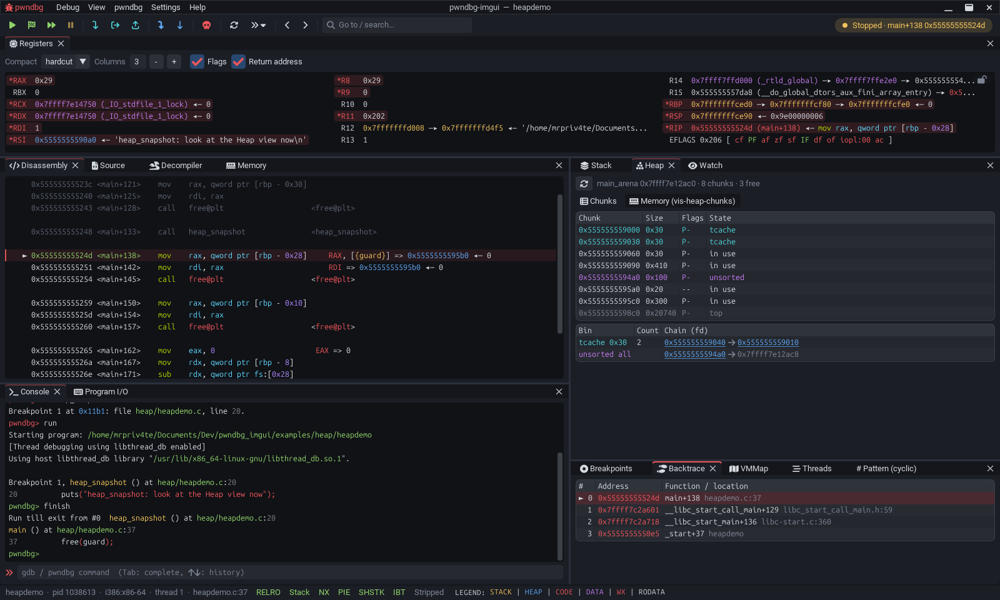
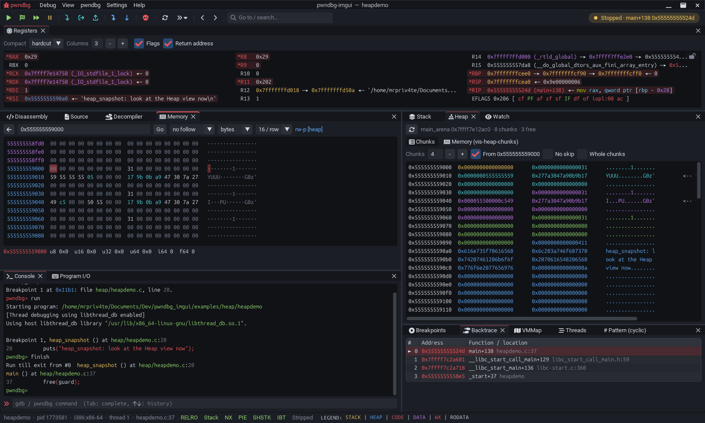
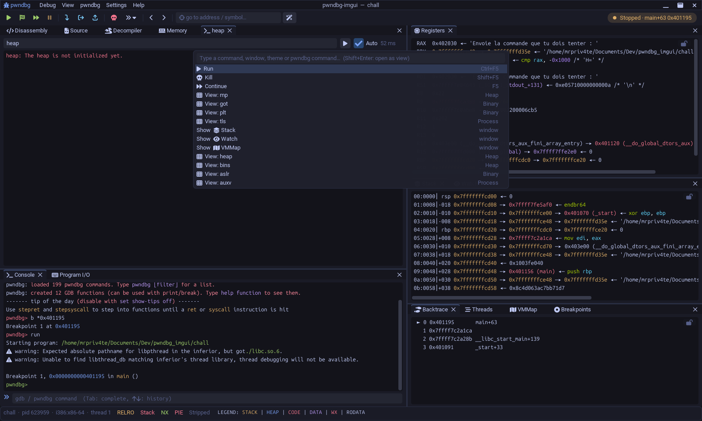

<div align="center">

# 🐞 pwndbg-imgui

**A dockable graphical front-end for [pwndbg](https://pwndbg.re), Ghidra / IDA style.**

Every context section in its own movable window, plus tools that drive pwndbg directly —
all while keeping the gdb console one keystroke away.




</div>

---

## ✨ At a glance

| | |
|---|---|
| 🧩 **Dockable context** | Registers, Disassembly, Source, Stack, Backtrace, Watch… rearrange freely |
| 🖱️ **Everything is clickable** | hover → region + deref chain, Ctrl+click → memory, right-click → actions |
| 🧠 **Decompiler** | Ghidra / IDA / Binary Ninja via decomp2dbg, whole function following `$pc` |
| 🔬 **Editable memory** | region-colored hexdump, diff on every stop, in-place editing |
| ⌨️ **Program I/O** | a terminal just for the target, pwntools-style payloads (`p64`, `cyclic`, `flat`) |
| 🎨 **13 themes** | dark & light, contrast auto-corrected, themed title bar |
| 🪄 **Palette** | <kbd>Ctrl</kbd>+<kbd>P</kbd> for everything: commands, windows, themes, views |
| 🐍 **pwntools** | attaches to `gdb.debug` / `gdb.attach`, ships an `exploit.py` template |

---

## 📦 Installation

### 1. pwndbg

pwndbg-imgui is a front-end for your existing **pwndbg** + **gdb**, so install pwndbg first
([official guide](https://pwndbg.re/stable/setup/)). The recommended methods — the install
script, `uv`, Homebrew, Nix, or a distro package — all give you a **`pwndbg` command**:

```bash
# official install script (latest portable release), user-only:
curl --proto '=https' --tlsv1.2 -LsSf 'https://install.pwndbg.re' | sh -s -- -t pwndbg-gdb -u
```

> [!TIP]
> If `pwndbg` is on your `PATH`, pwndbg-imgui uses it automatically — nothing else to set up.
> With a classic "`source .../gdbinit.py` in `~/.gdbinit`" install it also works: pwndbg-imgui
> then runs plain `gdb` and lets your gdbinit load pwndbg (or a user-defined `init-pwndbg`
> command, or a known path like `~/.local/share/pwndbg`). Override with `--gdb PATH`,
> `--pwndbg PATH`, or `--init-cmd CMD`.

Quick check (any one of these should print a `Pwndbg: 2026.xx.xx …` line):

```bash
pwndbg -q -batch -ex 'version'                   # a `pwndbg` launcher is installed
gdb   -q -batch -ex 'version'                    # pwndbg auto-loaded by your gdbinit
gdb   -q -batch -ex 'init-pwndbg' -ex 'version'  # manual `init-pwndbg` command
```

### 2. pwndbg-imgui

With [pipx](https://pipx.pypa.io), in its own environment (imgui-bundle included):

```bash
pipx install git+https://github.com/mrpriv4te/pwndbg-imgui   # straight from GitHub
pipx install .                 # from a clone of this repo
pipx install -e .              # for development: code changes are picked up live
pipx upgrade pwndbg-imgui      # after a `git pull` (without -e: `pipx install --force .`)
```

The `pwndbg-imgui` command is then available (`python -m pwndbg_imgui` works too).

---

## 🚀 Usage

Like `pwndbg` / `gdb`: anything that is not a GUI option is passed straight to gdb.

```bash
pwndbg-imgui ./chall
pwndbg-imgui --args ./chall arg1 arg2
pwndbg-imgui -p 1234
pwndbg-imgui ./chall core
pwndbg-imgui -ex 'target remote :1234' ./chall
```

GUI options: `--gdb PATH`, `--pwndbg PATH`, `--init-cmd CMD`, `--no-pwndbg`,
`--theme NAME`, `--font PATH`, `--font-size N`, `--no-io`, `--no-viewports`, `--maximize`,
`--reset-layout`, `--list-themes`, `--version`, `--debug` (see `--help`).

Something misbehaving? Run with `--debug` (or set `PWNDBG_IMGUI_DEBUG=1`, which also
works for the attached mode): errors that are normally handled silently, on both the
GUI and the gdb side, are logged with tracebacks to `~/.cache/pwndbg-imgui-debug.log`.
Please attach that file to bug reports.

### 🦾 Other architectures (ARM, AArch64, MIPS…)

Run the target under qemu-user's gdbserver and attach with a multi-arch gdb (the `pwndbg`
launcher, or `gdb-multiarch`):

```bash
qemu-aarch64 -g 1234 ./chall &                     # or qemu-arm, qemu-mips, … (-L sysroot if dynamic)
pwndbg-imgui --gdb gdb-multiarch -ex 'target remote :1234' ./chall
```

The panes follow the target: pointer-sized words and byte order in the Memory view and
payloads (e.g. 4-byte big-endian on MIPS), registers to follow per architecture (`$x0`,
`$r0`, `$a0`…), cyclic subsequence size. Tested on AArch64, ARM and big-endian MIPS. The
program's input/output are in qemu's terminal (Program I/O is disabled for remote targets).

### 🔗 Attach to an existing gdb session

To open the GUI from an already-running gdb (e.g. pwntools' `gdb.debug` / `gdb.attach`),
add the `init-pwndbg-imgui` command to your gdbinit once:

```bash
pwndbg-imgui --gdbinit >> ~/.config/gdb/gdbinit
```

Then, in any gdb session:

```text
(gdb) init-pwndbg-imgui        # loads pwndbg if needed and opens the GUI, attached to this gdb
```

gdb keeps its terminal (that's where the program and its input live); the GUI shows the
context and drives gdb. Closing the GUI hands the context back to the terminal.
`$PWNDBG_IMGUI_ARGS` passes options (e.g. `export PWNDBG_IMGUI_ARGS=--maximize`).

### 🐍 With pwntools

In a script, add `init-pwndbg-imgui` to the `gdbscript`, or set
`context.gdb_binary = "pwndbg-imgui"`. A ready-to-use template (with a `-d ui` option) is
generated by:

```bash
pwndbg-imgui --exploit            # creates ./exploit.py
pwndbg-imgui --exploit > e.py     # or to another file
```

```bash
./exploit.py            # local
./exploit.py -d         # debug: gdb in a new terminal
./exploit.py -d ui      # debug: the pwndbg-imgui GUI
./exploit.py -r --host HOST --port PORT
```

---

## 🖼️ Gallery

| Memory view | Command palette |
|:---:|:---:|
|  |  |

---

## 🎛️ Features

- **🧩 pwndbg context** — Registers, Disassembly, Source, Stack, Backtrace, Arguments, Watch,
  Threads, Heap Tracker, Last Signal. Each section fits its window (disasm/stack/source/
  backtrace show exactly as many lines as are visible) and only the shown sections are
  computed.
- **🖱️ Clickable addresses everywhere** — hover = memory region + pwndbg deref chain;
  <kbd>Ctrl</kbd>+click = open in the memory view; right-click = telescope, disassemble,
  xinfo, find pointers, breakpoint, watchpoint…
- **🧠 Decompiler** — whole-function view via the decomp2dbg integration
  (Ghidra / IDA / Binary Ninja / angr), syntax highlighting, follows `$pc`, auto
  connect/sync.
- **🔴 Breakpoints** — click the Disassembly/Source gutter, a dedicated window (enable,
  conditions, hit counts, watchpoints), offered for restore per binary.
- **💻 gdb console** — colors, persistent history, <kbd>Tab</kbd> completion (via gdb),
  empty Enter repeats the last command, <kbd>Ctrl</kbd>+<kbd>C</kbd> interrupts.
- **⌨️ Program I/O** — the program gets its own terminal (stdin/stdout separate from gdb),
  raw mode (binary-safe). Send as text, hex, or a pwntools-style Python expression
  (`b"A"*40 + p64(0x401136)`, `flat(...)`, `cyclic(100)`), non-printables shown as `\xNN`,
  plus a hexdump view of the output.
- **🔬 Memory** — region-colored hexdump / pointer-sized words (pwndbg legend), bytes changed
  since the last stop highlighted, in-place editing (type hex digits), follow an expression
  (`$sp`, `$rdi`…), value inspector.
- **🧱 Heap** (glibc) — every chunk of the current arena with its size, flags and state
  (in use, tcache, fastbin, unsorted, small/large bin, top), and the non-empty bins with their
  chains; addresses open in Memory. Built on pwndbg's heap model, refreshed at each stop
  (**View → Heap**).
- **🧰 Tools** — **VMMap**, a **command browser** (built-in help), a **pwndbg config editor**
  (remembered across runs), **live command views** refreshed on every stop (`heap`, `bins`,
  `vis_heap_chunks`, `got`, `telescope`…), a **cyclic pattern tool** (generate, send, find an
  offset from `$pc`/`$sp`).
- **🪄 Comfort** — one search box / command palette (<kbd>Ctrl</kbd>+<kbd>P</kbd>): type an
  address, symbol or expression to open it in Memory, disassemble or telescope it, or find any
  command, view, window or theme; toolbar
  (Run/Start/Continue/Pause/Step…), status bar (pid, arch, checksec, legend), notifications
  (breakpoint, signal, exit).
- **🎨 Appearance** — 13 themes (dark and light, contrast auto-corrected), a themed title bar
  (drag to move, double-click to maximize), code zoom (<kbd>Ctrl</kbd>+wheel), system fonts,
  persistent layout and settings (`~/.config/pwndbg-imgui/`).

---

## ⌨️ Shortcuts

| Key | Action | | Key | Action |
|---|---|---|---|---|
| <kbd>F5</kbd> | Continue / Run | | <kbd>Ctrl</kbd>+<kbd>P</kbd> | Palette |
| <kbd>F6</kbd> | Pause | | <kbd>Ctrl</kbd>+<kbd>G</kbd> | Go to (same palette) |
| <kbd>F7</kbd> / <kbd>F8</kbd> | Step / Next (instruction) | | <kbd>Ctrl</kbd>+<kbd>F</kbd> | Find |
| <kbd>⇧</kbd>+<kbd>F7</kbd> / <kbd>F8</kbd> | Step / Next (source) | | <kbd>Ctrl</kbd>+wheel | Zoom code |
| <kbd>Ctrl</kbd>+<kbd>F7</kbd> | Finish | | <kbd>⇧</kbd>+<kbd>F5</kbd> | Kill |

<sub>Full list: <strong>Help → Keyboard shortcuts</strong> menu.</sub>

---

## ⚙️ Configuration

Settings and layout live in **`~/.config/pwndbg-imgui/`** (honors `$XDG_CONFIG_HOME`):

| File | What it holds |
|---|---|
| `settings.json` | preferences and remembered state (plain JSON) |
| `layout.ini` | window layout and geometry, managed by the docking system |

Almost everything is set through the GUI — the **Settings** menu, the **Preferences**
window, and the **pwndbg Config** pane — so you rarely edit the file by hand. What
`settings.json` keeps:

- **Appearance** — `theme`, `ui_size`, `code_size`, `font`, `custom_titlebar`, `viewports`,
  `fps_idle`.
- **Behavior** — `autofit`, `remember_bps`, `persist_pwndbg_config`, `decomp_autoconnect`,
  `io_raw` / `io_echo` / `io_newline`.
- **Remembered state** — `console_history` and `io_history`, `views` (open command views),
  `pwndbg_config` (pwndbg parameters you changed, re-applied each run), and `binaries`
  (per-binary breakpoints and run arguments).

To reset: delete the file (or the whole directory) to restore defaults, or pass
`--reset-layout` to rebuild just the default window layout. Breakpoints are offered for
restore per binary (toggle with `remember_bps`), and changed pwndbg parameters are
re-applied each run (toggle in the Config pane or with `persist_pwndbg_config`).

---

## 🛠️ How it works

Two modes, one agent on the gdb side:

- **Launched by the GUI** (`pwndbg-imgui ./chall`) — the GUI creates one PTY for the gdb
  console and one for the program, then starts the debugger (the `pwndbg` launcher if
  present, else `gdb`) and has it load `agent.py`.
- **Attached** (`init-pwndbg-imgui`) — gdb keeps its terminal; `agent.attach()` launches the
  GUI and hands it a `socketpair`. Closing the GUI gives the context back to the terminal.

In both cases gdb loads `agent.py` **by its path**: gdb uses its own Python (pwndbg's), which
must not see the pipx environment. The agent (standard library only) routes each context
section to the GUI (`contextoutput` with a callable) and answers JSON requests (memory,
vmmap, breakpoints, completion, decompilation, console…) over the `socketpair`.

<details>
<summary>Project layout</summary>

```text
src/pwndbg_imgui/
├── cli.py            entry point, options (imports the GUI only at launch)
├── agent.py          gdb side (standard library only)
├── transport.py      RPC client + PTYs
├── term.py           small terminal emulator (ANSI)
├── theme.py          colors and themes
├── settings.py       persistent settings
├── fonts.py          font discovery (fontconfig)
├── payload.py        cyclic, payload expressions, hexdump
├── registers.py      register cells in the regs pane
├── templates/        exploit.py template (--exploit)
└── ui/
    ├── app.py        state, gdb process, events, hello_imgui runner
    ├── chrome.py     menus, toolbar/title/status bar, palette, dialogs
    ├── panels.py     tool windows (console, I/O, commands, config…)
    ├── panes.py      standalone panes (vmmap, breakpoints, heap)
    ├── sections.py   per-context-section behavior
    ├── views.py      memory, decompiler and command views
    ├── widgets.py    TextView and helpers
    ├── appearance.py fonts and theme application
    ├── native.py     GLFW window control (title bar)
    └── catalog.py    sections and tool presets
```

</details>

---

<div align="center">
<sub>Built with <a href="https://pwndbg.re">pwndbg</a> and
<a href="https://github.com/pthom/imgui_bundle">imgui_bundle</a>.</sub>
</div>
