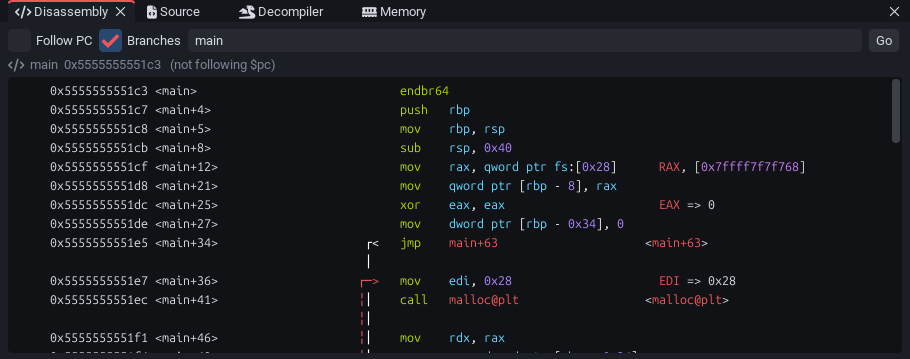
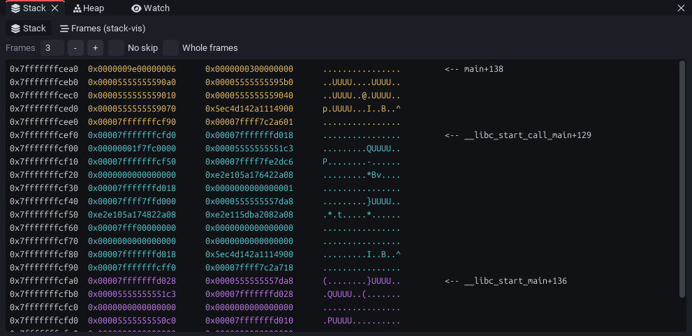
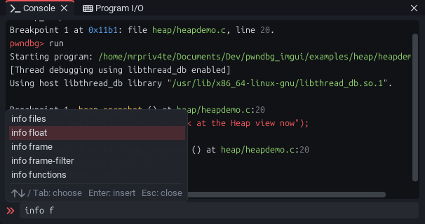

**This release brings the new disassembly and stack features of pwndbg 2026.09.15 into the GUI: disassemble any function or address in the Disassembly window (whole functions with `nearpc -f`, optional branch arrows), a Frames tab in the Stack window for the new `stack-vis` command, and console completion you can actually pick from.**

See below for screenshots and more info! Both pwndbg features need **pwndbg 2026.09.15 or newer**; with an older pwndbg the GUI falls back gracefully (details below).

----

### Disassemble any function or address

Untick **Follow PC** in the Disassembly window and type a function or an address (`main`, `0x401156`, `$pc+0x40`), or use **Disassemble** from the go-to box, the right-click menu of any address or a backtrace frame: the window shows the whole function with pwndbg's `nearpc -f`, with pwndbg's colors, annotations and breakpoint markers. Where pwndbg finds no function boundaries (stripped code, shellcode), it falls back to `nearpc -r 0` from that address and loads more instructions as you scroll, like the stack.

* **Branches** toggles pwndbg's branch arrows (`nearpc` without `-n`); the choice is remembered.
* Clicking the gutter, *Run to here*, *Set PC here* and *View bytes* work as in the regular view.
* *Disassemble* used to open a separate command window with a fixed `nearpc <addr> 30`.

### `stack-vis` in the Stack window

The Stack window gets a **Frames** tab next to pwndbg's stack, showing the new `stack-vis` command: the stack of the current thread split into frames, each labeled with its function, like the Heap's `vis-heap-chunks` tab. Set how many frames to draw (0 for all of them), *No skip* (`--no-skip`) and *Whole frames* (`--no-truncate`); it refreshes at each stop while shown.

### Pick a completion in the console

With several <kbd>Tab</kbd> matches, the list is no longer read-only: <kbd>↑</kbd>/<kbd>↓</kbd> or <kbd>Tab</kbd>/<kbd>Shift</kbd>+<kbd>Tab</kbd> move the highlight, <kbd>Enter</kbd> inserts the match, <kbd>Esc</kbd> closes the list.

### Others

* The completion list stays open when <kbd>Tab</kbd> extends the input to the matches' common prefix (it used to close at once), and <kbd>Esc</kbd> no longer wipes the typed line.
* With a pwndbg older than 2026.09.15, *Disassemble* shows the instructions from the address on instead of the whole function, and the Stack window has no Frames tab.
* README screenshots retaken.
